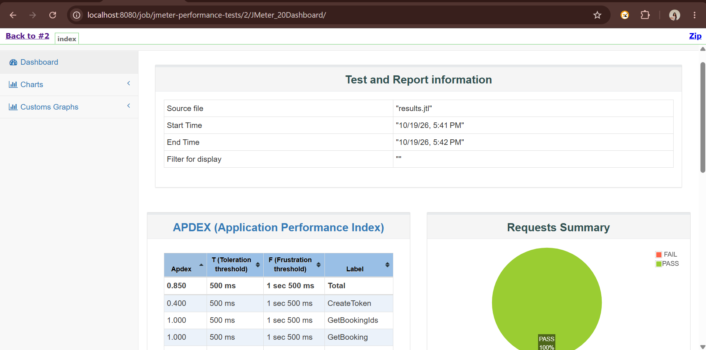
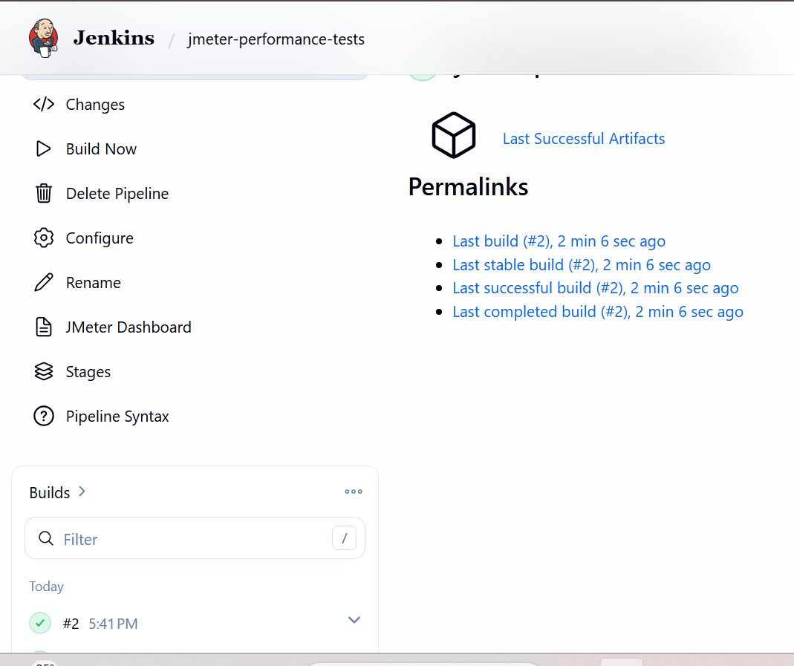

# Restful-Booker Performance Tests (JMeter + Jenkins)

## What this tests
Performance and functional checks on the public Restful-Booker API (restful-booker.herokuapp.com): token creation, booking creation, fetching a booking, and filtering booking IDs.

## Test flow
1. **CreateToken**: logs in and extracts the token for later requests (the token will be used by the update and delete requests, which are planned next).
2. **CreateBooking**: creates a booking and extracts the `bookingid`. Response code assertion checks for 200.
3. **GetBooking**: reads the booking back using the extracted `bookingid`.
4. **GetBookingIds**: filters bookings by first name and last name, with an assertion on the response.

## Load
5 users with a 5-second ramp-up. The load is kept small because this is a public shared API and I don't want to cause issues for other users.

## How to run
```
jmeter -n -t test-plans/restful-booker_demo.jmx -l results/results.jtl -e -o results/report
```
Then open `results/report/index.html` to see the dashboard.

## CI/CD
A Jenkins pipeline pulls this repo from GitHub, runs the test plan in JMeter non-GUI mode, and publishes the HTML dashboard.




## Planned improvements
- Add PUT, PATCH and DELETE requests using the token
- More assertions and timers
- Fail the Jenkins build when assertions fail